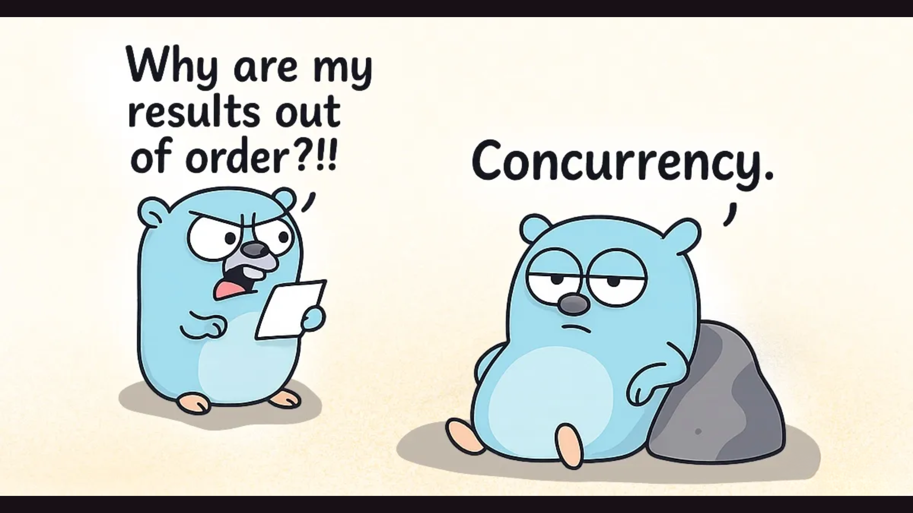
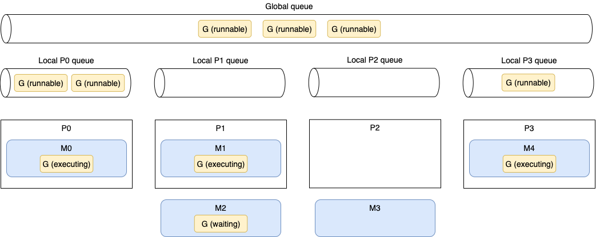
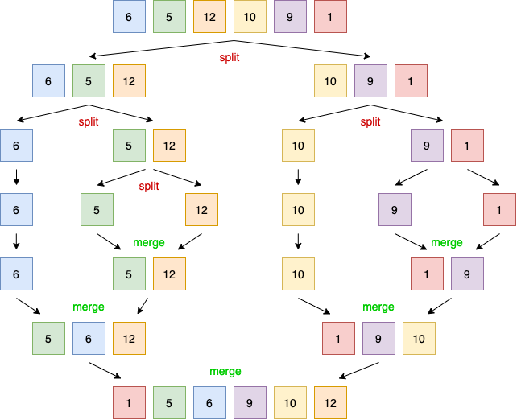

# Concorrência vs Paralelismo em Go: Desmistificando Mitos de Performance

Disponível em:   [English](https://huncoding.com/concurrency-vs-parallelism-go-performance-myths/)

Postado em  13/10/2025    Atualizado  01/10/2026  

[](../assets/images/2025-10-13-concorrencia-vs-paralelismo-go-mitos-performance-63079fbde510.png)

Por  *[Otavio Celestino dos Santos](https://github.com/HunCoding)*  

11 min

E aí, pessoal! Hoje vou esclarecer um dos conceitos mais mal compreendidos em Go: **concorrência vs paralelismo**. Muitos desenvolvedores acreditam que soluções concorrentes são sempre mais rápidas, mas essa é uma concepção perigosa que pode levar a pior performance.

## O Agendamento do Go

Um thread é a menor unidade de processamento que um SO pode executar. Se um processo quer executar múltiplas ações simultaneamente, ele cria múltiplos threads. Esses threads podem ser:

- *Concorrentes* — Dois ou mais threads podem começar, executar e completar em períodos de tempo sobrepostos.- *Paralelos* — A mesma tarefa pode ser executada múltiplas vezes ao mesmo tempo.

O SO é responsável por agendar os processos dos threads de forma otimizada para que:

- Todos os threads possam consumir ciclos de CPU sem ficar famintos por muito tempo.- A carga de trabalho seja distribuída o mais uniformemente possível entre os diferentes cores de CPU.

Um core de CPU executa diferentes threads. Quando ele muda de um thread para outro, executa uma operação chamada *context switching*. O thread ativo consumindo ciclos de CPU estava em um estado *executando* e move para um estado *executável*, significando que está pronto para ser executado pendente de um core disponível. Context switching é considerado uma operação cara porque o SO precisa salvar o estado atual de execução de um thread antes da mudança (como os valores atuais dos registradores).

Como desenvolvedores Go, não podemos criar threads diretamente, mas podemos criar goroutines, que podem ser pensadas como threads de nível de aplicação. No entanto, enquanto um thread do SO é context-switched dentro e fora de um core de CPU pelo SO, uma goroutine é context-switched dentro e fora de um thread do SO pelo runtime do Go. Além disso, comparado a um thread do SO, uma goroutine tem uma pegada de memória menor: 2 KB para goroutines do Go 1.4. Um thread do SO depende do SO, mas, por exemplo, no Linux/x86–32, o tamanho padrão é 2 MB.

Context switching uma goroutine versus um thread é cerca de 80% a 90% mais rápido, dependendo da arquitetura.

> **Observação Importante**
>
> A diferença de performance entre goroutines e threads é significativa. Enquanto um thread do SO tem 2MB de stack (Linux/x86-32), uma goroutine tem apenas 2KB. Isso significa que o Go pode criar milhares de goroutines com o mesmo overhead de memória que algumas dezenas de threads.

Vamos agora discutir como o scheduler do Go funciona para ter uma visão geral de como as goroutines são tratadas. Internamente, o scheduler do Go usa a seguinte terminologia:

- *G* — Goroutine- *M* — Thread do SO (significa machine)- *P* — Core de CPU (significa processor)

Cada thread do SO (M) é atribuído a um core de CPU (P) pelo scheduler do SO. Então, cada goroutine (G) executa em um M. A variável GOMAXPROCS define o limite de Ms responsáveis por executar código de nível de usuário simultaneamente. Mas se um thread está bloqueado em uma chamada de sistema (por exemplo, I/O), o scheduler pode criar mais Ms. A partir do Go 1.5, GOMAXPROCS é por padrão igual ao número de cores de CPU disponíveis.

Uma goroutine tem um ciclo de vida mais simples que um thread do SO. Ela pode estar fazendo uma das seguintes coisas:

- *Executando* — A goroutine está agendada em um M e executando suas instruções.- *Executável* — A goroutine está esperando para estar em um estado executando.- *Esperando* — A goroutine está parada e pendente de algo completar, como uma chamada de sistema ou uma operação de sincronização (como adquirir um mutex).

Há um último estágio para entender sobre a implementação do agendamento do Go: quando uma goroutine é criada mas não pode ser executada ainda; por exemplo, todos os outros Ms já estão executando um G. Neste cenário, o que o runtime do Go fará sobre isso? A resposta é enfileiramento. O runtime do Go trata dois tipos de filas: uma fila local por P e uma fila global compartilhada entre todos os Ps.

[](../assets/images/go-scheduler-506beaae7b94.png)

A Figura 1 mostra uma situação de agendamento específica em uma máquina de quatro cores com GOMAXPROCS igual a 4. As partes são os cores lógicos (Ps), goroutines (Gs), threads do SO (Ms), filas locais e fila global.

Primeiro, podemos ver cinco Ms, enquanto GOMAXPROCS está definido como 4. Mas como mencionamos, se necessário, o runtime do Go pode criar mais threads do SO que o valor GOMAXPROCS.

P0, P1 e P3 estão atualmente ocupados executando threads do runtime do Go. Mas P2 está atualmente ocioso enquanto M3 está desligado de P2, e não há goroutine para ser executada. Esta não é uma boa situação porque seis goroutines executáveis estão pendentes de serem executadas, algumas na fila global e algumas em outras filas locais. Como o runtime do Go lidará com esta situação? Aqui está a implementação do agendamento em pseudocódigo:


```plaintext
runtime.schedule() {
    // Apenas 1/61 do tempo, verifica a fila global executável por um G.
    // Se não encontrado, verifica a fila local.
    // Se não encontrado,
    //     Tenta roubar de outros Ps.
    //     Se não, verifica a fila global executável.
    //     Se não encontrado, faz polling da rede.
}
```


A cada sexagésima primeira execução, o scheduler do Go verificará se goroutines da fila global estão disponíveis. Se não, verificará sua fila local. Enquanto isso, se tanto as filas global quanto local estiverem vazias, o scheduler do Go pode pegar goroutines de outras filas locais. Este princípio no agendamento é chamado *work stealing*, e permite que um processador subutilizado procure ativamente por goroutines de outro processador e *roube* algumas.

> **Conceito Chave: Work Stealing**
>
> Work stealing é uma técnica fundamental do scheduler do Go. Quando um processador (P) fica ocioso, ele não fica parado esperando - ele ativamente “rouba” goroutines de outros processadores que estão sobrecarregados. Isso garante que todos os cores sejam utilizados eficientemente.

Uma última coisa importante a mencionar: antes do Go 1.14, o scheduler era cooperativo, o que significava que uma goroutine poderia ser context-switched fora de um thread apenas em casos específicos de bloqueio (por exemplo, envio ou recebimento de channel, I/O, esperando adquirir um mutex). Desde o Go 1.14, o scheduler do Go agora é preemptivo: quando uma goroutine está executando por uma quantidade específica de tempo (10 ms), ela será marcada como preemptível e pode ser context-switched fora para ser substituída por outra goroutine. Isso permite que um trabalho de longa duração seja forçado a compartilhar tempo de CPU.

Agora que entendemos os fundamentos do agendamento em Go, vamos ver um exemplo concreto: implementar um merge sort de forma paralela.

## Merge Sort Paralelo

Primeiro, vamos revisar brevemente como o algoritmo de merge sort funciona. Então implementaremos uma versão paralela. Note que o objetivo não é implementar a versão mais eficiente, mas apoiar um exemplo concreto mostrando por que concorrência nem sempre é mais rápida.

O algoritmo de merge sort funciona quebrando uma lista repetidamente em duas sublistas até que cada sublista consista de um único elemento e então mesclando essas sublistas para que o resultado seja uma lista ordenada. Cada operação de divisão divide a lista em duas sublistas, enquanto a operação de mesclagem mescla duas sublistas em uma lista ordenada.

[](../assets/images/mergesort-4e599cde0e37.png)

Figura 2: Aplicando o algoritmo de merge sort quebra repetidamente cada lista em duas sublistas. Então o algoritmo usa uma operação de mesclagem para que a lista resultante seja ordenada.

Aqui está a implementação sequencial deste algoritmo:


```go
func mergeSortSequencial(s []int) {
    if len(s) <= 1 {
        return
    }

    meio := len(s) / 2
    mergeSortSequencial(s[:meio]) // Primeira metade
    mergeSortSequencial(s[meio:]) // Segunda metade
    merge(s, meio) // Mescla as duas metades
}

func merge(s []int, meio int) {
    // Detalhes da implementação...
}
```


Este algoritmo tem uma estrutura que o torna aberto à concorrência. De fato, como cada operação *mergeSortSequencial* trabalha em um conjunto independente de dados que não precisa ser totalmente copiado (aqui, uma visão independente do array subjacente usando slicing), poderíamos distribuir esta carga de trabalho entre os cores de CPU criando cada operação *mergeSortSequencial* em uma goroutine diferente. Vamos escrever uma primeira implementação paralela:


```go
func mergeSortParaleloV1(s []int) {
    if len(s) <= 1 {
        return
    }

    meio := len(s) / 2

    var wg sync.WaitGroup
    wg.Add(2)

    go func() { // Cria a primeira metade do trabalho em uma goroutine
        defer wg.Done()
        mergeSortParaleloV1(s[:meio])
    }()

    go func() { // Cria a segunda metade do trabalho em uma goroutine
        defer wg.Done()
        mergeSortParaleloV1(s[meio:])
    }()

    wg.Wait()
    merge(s, meio) // Mescla as metades
}
```


Nesta versão, cada metade da carga de trabalho é tratada em uma goroutine separada. A goroutine pai espera por ambas as partes usando *sync.WaitGroup*. Portanto, chamamos o método Wait antes da operação de mesclagem.

Agora temos uma versão paralela do algoritmo de merge sort. Portanto, se executarmos um benchmark para comparar esta versão com a sequencial, a versão paralela deveria ser mais rápida, correto? Vamos executá-la em uma máquina de quatro cores com 10.000 elementos:


```plaintext
Benchmark_mergeSortSequencial-4       2278993555 ns/op
Benchmark_mergeSortParaleloV1-4      17525998709 ns/op
```


Surpreendentemente, a versão paralela é quase uma ordem de magnitude mais lenta. Como podemos explicar este resultado? Como é possível que uma versão paralela que distribui uma carga de trabalho através de quatro cores seja mais lenta que uma versão sequencial executando em uma única máquina? Vamos analisar o problema.

> **Resultado**
>
> Este é um exemplo perfeito de como a intuição pode nos enganar! A versão paralela é **7.7x mais lenta** que a sequencial. Isso acontece porque o overhead de criar e gerenciar goroutines para tarefas muito pequenas supera os benefícios do paralelismo.

Se temos uma slice de, digamos, 1.024 elementos, a goroutine pai criará duas goroutines, cada uma responsável por tratar uma metade consistindo de 512 elementos. Cada uma dessas goroutines criará duas novas goroutines responsáveis por tratar 256 elementos, então 128, e assim por diante, até criarmos uma goroutine para computar um único elemento.

Se a carga de trabalho que queremos paralelizar é muito pequena, significando que vamos computá-la muito rapidamente, o benefício de distribuir um trabalho através de cores é destruído: o tempo que leva para criar uma goroutine e ter o scheduler executá-la é muito alto comparado a mesclar diretamente um número minúsculo de itens na goroutine atual. Embora goroutines sejam leves e mais rápidas de iniciar que threads, ainda podemos enfrentar casos onde uma carga de trabalho é muito pequena.

Então o que podemos concluir deste resultado? Isso significa que o algoritmo de merge sort não pode ser paralelizado? Espere, não tão rápido.

Vamos tentar outra abordagem. Porque mesclar um número minúsculo de elementos dentro de uma nova goroutine não é eficiente, vamos definir um threshold. Este threshold representará quantos elementos uma metade deve conter para ser tratada de forma paralela. Se o número de elementos na metade for menor que este valor, trataremos sequencialmente. Aqui está uma nova versão:


```go
const max = 2048 // Define o threshold

func mergeSortParaleloV2(s []int) {
    if len(s) <= 1 {
        return
    }

    if len(s) <= max {
        mergeSortSequencial(s) // Chama nossa versão sequencial inicial
    } else { // Se maior que o threshold, mantém a versão paralela
        meio := len(s) / 2

        var wg sync.WaitGroup
        wg.Add(2)

        go func() {
            defer wg.Done()
            mergeSortParaleloV2(s[:meio])
        }()

        go func() {
            defer wg.Done()
            mergeSortParaleloV2(s[meio:])
        }()

        wg.Wait()
        merge(s, meio)
    }
}
```


Se o número de elementos na slice s for menor que max, chamamos a versão sequencial. Caso contrário, continuamos chamando nossa implementação paralela. Esta abordagem impacta o resultado? Sim, impacta:


```plaintext
Benchmark_mergeSortSequencial-4       2278993555 ns/op
Benchmark_mergeSortParaleloV1-4      17525998709 ns/op
Benchmark_mergeSortParaleloV2-4       1313010260 ns/op
```


Nossa implementação paralela v2 é mais de 40% mais rápida que a sequencial, graças a esta ideia de definir um threshold para indicar quando paralelo deve ser mais eficiente que sequencial.

Por que defini o threshold como 2.048? Porque era o valor ótimo para esta carga de trabalho específica na minha máquina. Em geral, tais valores mágicos devem ser definidos cuidadosamente com benchmarks (executando em um ambiente de execução similar à produção). Também é bastante interessante notar que executar o mesmo algoritmo em uma linguagem de programação que não implementa o conceito de goroutines tem um impacto no valor.

## Conclusão

Vimos ao longo deste post os conceitos fundamentais de agendamento em Go: as diferenças entre um thread e uma goroutine e como o runtime do Go agenda goroutines. Enquanto isso, usando o exemplo do merge sort paralelo, ilustramos que concorrência nem sempre é necessariamente mais rápida. Como vimos, criar goroutines para tratar cargas de trabalho mínimas (mesclando apenas um pequeno conjunto de elementos) destrói o benefício que poderíamos obter do paralelismo.

Então, para onde devemos ir a partir daqui? Devemos ter em mente que concorrência nem sempre é mais rápida e não deve ser considerada a forma padrão de ir para todos os problemas. Primeiro, torna as coisas mais complexas. Além disso, CPUs modernas se tornaram incrivelmente eficientes em executar código sequencial e código previsível. Por exemplo, um processador superscalar pode paralelizar execução de instruções sobre um único core com alta eficiência.

Isso significa que não devemos usar concorrência? Claro que não. No entanto, é essencial manter essas conclusões em mente. Se não temos certeza de que uma versão paralela será mais rápida, a abordagem correta pode ser começar com uma versão sequencial simples e construir a partir daí usando profiling e benchmarks, por exemplo. Pode ser a única forma de garantir que uma implementação concorrente vale a pena.

## Referências

- [Go Concurrency Patterns](https://go.dev/blog/pipelines)- [Effective Go - Concurrency](https://go.dev/doc/effective_go#concurrency)- [Go Scheduler Design](https://docs.google.com/document/d/1TTj4T2JO42uD5ID9e89oa0sLKhJYD0Y_kqxDv3I3XMw/edit)- [Concorrência não é Paralelismo - Rob Pike](https://www.youtube.com/watch?v=cN_DpYBzKso)- [Go Runtime Scheduler](https://golang.org/src/runtime/proc.go)- [Performance Optimization in Go](https://go.dev/doc/diagnostics)- [Go Profiling Guide](https://go.dev/blog/pprof)- [Concurrent Programming Patterns](https://github.com/golang/go/wiki/LearnConcurrency)

[Go](https://huncoding.com/categories/go/), [Performance](https://huncoding.com/categories/performance/), [Concorrência](https://huncoding.com/categories/concorr%C3%AAncia/)

[go](https://huncoding.com/tags/go/) [concurrency](https://huncoding.com/tags/concurrency/) [parallelism](https://huncoding.com/tags/parallelism/) [performance](https://huncoding.com/tags/performance/) [goroutines](https://huncoding.com/tags/goroutines/) [scheduler](https://huncoding.com/tags/scheduler/)

[Me compre um café ☕](https://ko-fi.com/huncoding)


---
Fonte: [https://huncoding.com/concorrencia-vs-paralelismo-go-mitos-performance/](https://huncoding.com/concorrencia-vs-paralelismo-go-mitos-performance/)
